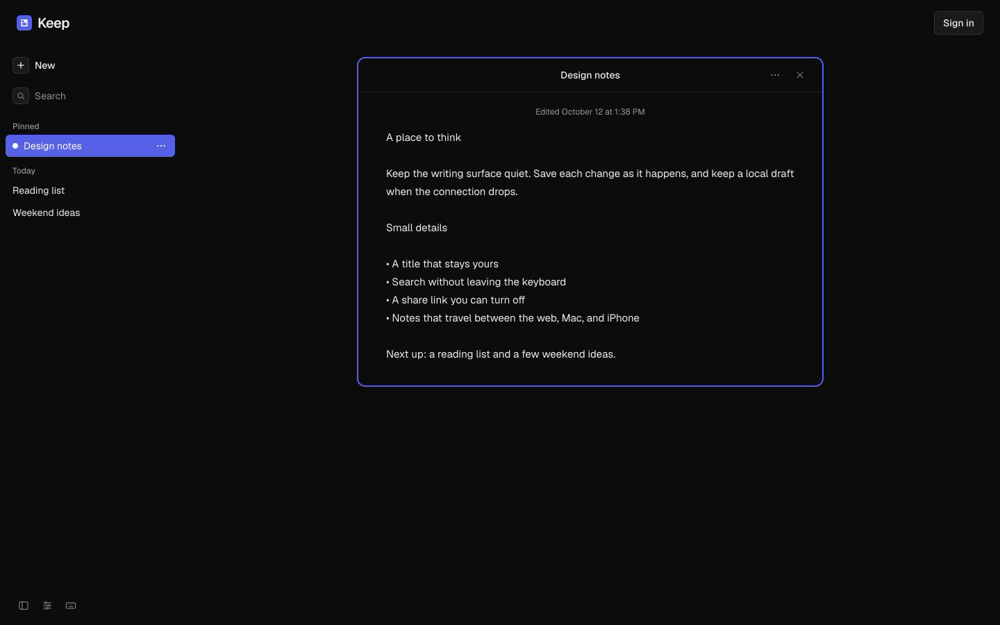

# Keep

Keep is a notes app for the web, iPhone, iPad, and Mac. Open a note, write,
and it saves as you go. You can start without an account and sign in later
to bring your notes across devices.

**[Try Keep at keeptxt.com](https://keeptxt.com)** — no account needed to try
the web editor. Create a note, type a few lines, and reload the page. Guest
notes stay in that browser until you sign in; clearing site data removes them.



## What you can do

- Write plain text or Markdown, with a preview and optional code highlighting.
- Find notes with search, tags, color labels, and keyboard shortcuts.
- Pin the notes you use often, archive the rest, and restore notes from trash.
- Sign in to sync across devices and share a note through a link you can revoke.
- On the web, import Google Keep exports, text, Markdown, ZIPs, or PDFs, and
  export your notes as text or a ZIP.

The [iOS and macOS apps](./ios/README.md) use SwiftUI and the same API as the
web app. They share models and sync code, with interfaces built for each
platform. The native README has screenshots, build instructions, and current
feature gaps.

## How it works

The web app uses **Next.js 16, React 19, TypeScript, and Tailwind CSS**.
**Postgres** stores signed-in notes, and **Auth.js** handles Google and
verified email/password sign-in. Guest notes live in the browser; signed-in
accounts also have an IndexedDB cache and a queue for interrupted saves.

Some of the work behind the editor:

- **Saving while you keep typing.** A local draft is recorded before the
  network request. Saves check the version they started from, so a conflict
  keeps your draft and offers recovery instead of silently replacing another
  device's edits. See the [save logic](./lib/saveNoteDraft.ts) and
  [conflict tests](./__tests__/conditionalDraftSave.test.ts).
- **Moving from guest mode to an account.** Migration can retry after a partial
  failure without duplicating notes or discarding text edited along the way.
  The [save-order tests](./__tests__/saveOrderIntegration.test.tsx) cover this
  alongside edits that arrive during a pending save.
- **Recovering from a bad release.** Production runs on Proxmox behind
  Cloudflare Tunnel, with Postgres on a separate VM. A candidate release passes
  health checks before it becomes active; failed activation rolls back to the
  previous release. The [operator runbook](./ops/README.md) and
  [release tests](./ops/tests/activate-release.sh) explain that path.

## Run it locally

Use Node.js 22, as specified in [`.nvmrc`](./.nvmrc). If you use nvm:

```bash
git clone https://github.com/fjbarrett/keep.git
cd keep
nvm use
npm ci
cp .env.example .env.local
```

For a first look, guest mode needs no database or external service keys.
In `.env.local`, replace these values (generate a secret with
`openssl rand -base64 32`):

```dotenv
AUTH_SECRET=your-generated-secret
AUTH_URL=http://localhost:3000
APP_URL=http://localhost:3000
DATABASE_URL=
```

Then start the app:

```bash
npm run dev
```

Open [localhost:3000](http://localhost:3000).
Without Postgres, analytics may log database warnings; guest editing still works.

To use accounts and sync, set `DATABASE_URL` to your Postgres connection
string. The app creates its tables on first use. Configure Google OAuth for
Google sign-in or Resend for production signup emails; in development,
verification links are logged when Resend is unset. The comments in
[`.env.example`](./.env.example) explain the settings, including optional
private image storage.

## Checks and tests

```bash
npm test
npx tsc --noEmit
npm run build
npm audit --omit=dev --audit-level=high
```

The Vitest suite covers editor behavior, save and sync races, draft recovery,
authentication, sharing, and import/upload limits. These checks and the release
rollback tests run in [web CI](./.github/workflows/ci.yml), using Node 22 and
npm 11. Production dependency advisories block releases at high severity and
above; build-tool advisories are reported separately.

[Native CI](./.github/workflows/native.yml) runs the shared Swift tests and
builds the iOS and Mac apps when native code changes. Browser automation is
currently used for screenshot capture; complete browser journeys are not yet
part of CI.

## Finding your way around

| Directory | What's there |
| --- | --- |
| [`app/`](./app) | Pages and API routes for notes, accounts, imports, and sharing |
| [`components/`](./components) | The editor, sidebar, note grid, and other web UI |
| [`lib/`](./lib) | Storage, sync, authentication helpers, and the database layer |
| [`ios/`](./ios) | SwiftUI apps and their shared models and services |
| [`__tests__/`](./__tests__) | Web unit, component, and route regression tests |
| [`ops/`](./ops) | Deployment, rollback, and database backup tooling |

## Limits and privacy

Offline support protects edits while the web app is already open. A full
reload still needs a connection because the service worker does not cache
personalized pages. Signing out clears that account's local data after a
warning about unsynced text. Native apps keep recoverable drafts but do not
yet store a full offline note catalogue.

Keep is **not end-to-end encrypted**: the server can read signed-in notes,
and browser copies are stored in plaintext. Anyone with a public share link
can read that note until you revoke the link. New image uploads use private
storage and are served through the app's access checks.

AI titles and summaries are optional. The example configuration disables them
with `AI_METADATA_ENABLED=false`. If an Anthropic key is configured and that
flag is not `false`, up to the first 8,192 characters of a signed-in note can
be sent to Anthropic. Guest text stays in the browser.

Accounts can store up to 10,000 notes and 25 MiB of note text and metadata;
attachments have separate limits. See [SECURITY.md](./SECURITY.md) for more
on data storage and vulnerability reporting, and [the runbook](./ops/README.md)
for hosting and backups.

## License

[MIT](./LICENSE).
